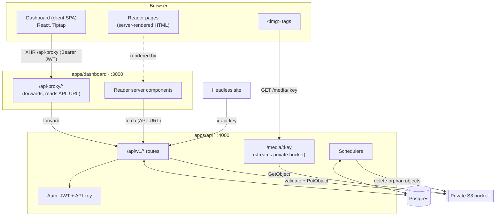
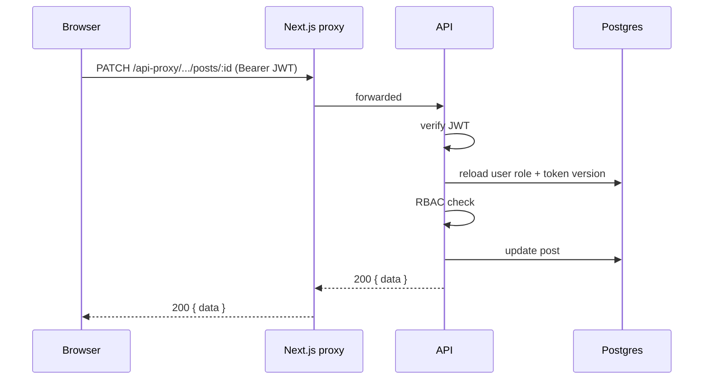
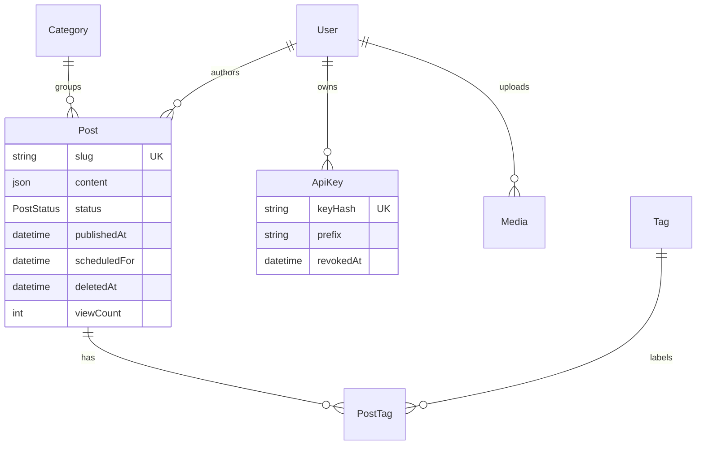
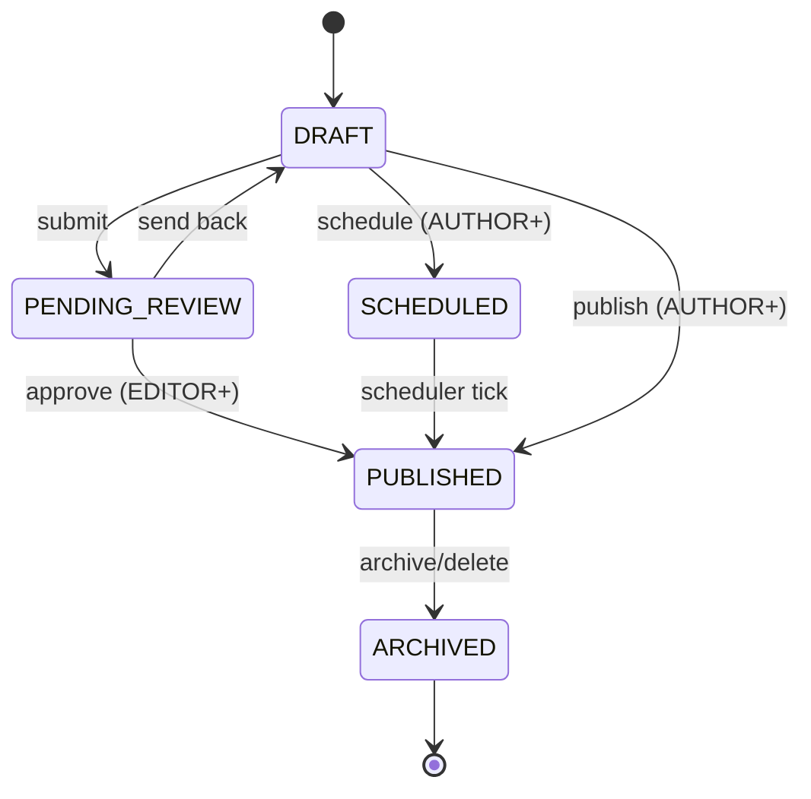

# Architecture

Three services: Next.js app (dashboard + reader), Fastify API, and Postgres.
The browser only talks to the Next.js app on the same origin and the dashboard proxies
authenticated calls to the API, so the API need not be exposed publicly.

Two distinct browser paths: the **dashboard** is a client SPA that calls the API
through the same-origin proxy with a Bearer token; the **reader** is server-rendered
(its server components fetch the API directly via `API_URL`), and the browser then
loads images from the API's `/media` route, which streams them from the private bucket.

## The proxy

Browser code calls `/api-proxy/...` (same origin). The
[proxy route](../apps/dashboard/src/app/api-proxy/[...path]/route.ts) reads
`API_URL` at request time and forwards the call. Result: the API needs no public
exposure, browser requests stay same-origin, and one image works in any environment
because the API host is read at runtime, not baked into the bundle. The session JWT
is kept in `localStorage` and sent as `Authorization: Bearer <token>`.

One exception: uploaded images are loaded by the browser from the API's `/media`
route (via `MEDIA_PUBLIC_BASE_URL`), not through the dashboard proxy. That route is
public and streams the object from the **private** bucket using the server's S3
credentials — so the bucket is never exposed and the store keys never reach the
browser. `MEDIA_PUBLIC_BASE_URL` must be the API as the browser reaches it.

## Request flow

On every authenticated request the API reloads the user's role from the database
rather than trusting the JWT, so demotions and deletions apply immediately. The
same lookup compares the token's `tv` claim against the user's `tokenVersion`,
which a password change increments — so older tokens stop working then too. See
[auth.ts](../apps/api/src/plugins/auth.ts).

Writes that span more than one statement (replacing a post's tags, deleting a
user, the last-super-admin checks, first-run bootstrap) run in a transaction, the
last three at `Serializable`, so a concurrent request cannot slip between the
check and the write.

## Data model

- Post content is JSONB — a Tiptap document (`{ type: "doc", content: [...] }`),
  validated against the editor's node types and size limits before it is stored
  ([content.ts](../apps/api/src/lib/content.ts)).
- `User.tokenVersion` increments on password change; JWTs carry it as `tv`.
- Soft deletes set `deletedAt` and `ARCHIVED`; queries filter `deletedAt: null`.
- Deleting a user reassigns their posts/media to the acting super admin (author FK
  is required).

## Auth

Two credential types:

| Credential        | Used by            | Header                        | Verified in    |
| ----------------- | ------------------ | ----------------------------- | -------------- |
| JWT (7-day)       | Dashboard users    | `Authorization: Bearer <jwt>` | `authenticate` |
| API key (`czk_…`) | Headless consumers | `x-api-key: <key>`            | `apiKeyAuth`   |

JWTs are HS256 with a pinned issuer and audience. Passwords are bcrypt at
`BCRYPT_ROUNDS`. API keys are shown once; only a SHA-256 hash and 12-char prefix
are stored ([apiKey.ts](../apps/api/src/lib/apiKey.ts)).

## Request hardening

Applied in [app.ts](../apps/api/src/app.ts):

| Concern      | Handling                                                                      |
| ------------ | ----------------------------------------------------------------------------- |
| Headers      | `@fastify/helmet` with a strict CSP (JSON only; no user bytes served here).   |
| CORS         | Explicit origin list. `*` refused in production, credentials off with it.     |
| Rate limit   | 300/min per IP; 10/min on credential routes, 30/min on upload.                |
| Client IP    | From `TRUST_PROXY` only — off by default, so headers cannot be forged.        |
| Request body | 1 MiB JSON; uploads capped by `MAX_UPLOAD_BYTES`.                             |
| Errors       | Zod → `400`, known Prisma codes → `409`/`404`, everything else → plain `500`. |
| Logs         | `authorization`, `cookie`, `x-api-key` redacted.                              |

The error and not-found handlers are installed before the route plugins, since a
Fastify child context inherits whichever handler its parent had when it was
created.

## Roles (RBAC)

Ranked in [rbac.ts](../apps/api/src/lib/rbac.ts):
`SUPER_ADMIN(4) > EDITOR(3) > AUTHOR(2) > CONTRIBUTOR(1)`.

| Capability                          | Contributor | Author | Editor | Super admin |
| ----------------------------------- | :---------: | :----: | :----: | :---------: |
| Edit own posts                      |      Y      |   Y    |   Y    |      Y      |
| Edit anyone's posts                 |      -      |   -    |   Y    |      Y      |
| Publish / schedule                  |     -\*     |   Y    |   Y    |      Y      |
| Create categories/tags              |      -      |   -    |   Y    |      Y      |
| Mint API keys                       |      -      |   Y    |   Y    |      Y      |
| List users                          |      -      |   -    |   Y    |      Y      |
| Create / delete users, change roles |      -      |   -    |   -    |      Y      |

\* Contributor publish/schedule attempts are downgraded to `PENDING_REVIEW`.

The first account is created via the unauthenticated bootstrap endpoint as
`SUPER_ADMIN`. After that there is no public registration.

## Post lifecycle

## Background jobs

Both run inside the API process ([scheduler.ts](../apps/api/src/scheduler.ts)):

| Job           | Interval                                  | Action                                         |
| ------------- | ----------------------------------------- | ---------------------------------------------- |
| Publisher     | 60s                                       | Promotes due `SCHEDULED` posts to `PUBLISHED`. |
| Media cleanup | boot, then `MEDIA_CLEANUP_INTERVAL_HOURS` | Removes unreferenced uploads.                  |

## Stack

- API: Fastify 5, Prisma 7 (`@prisma/adapter-pg`), Zod 4, `@fastify/jwt`,
  `@fastify/helmet`, `@fastify/multipart` (10 MB), `@fastify/rate-limit`
  (300/min), `@aws-sdk/client-s3`, bcryptjs.
- Dashboard: Next.js 16 (standalone), React 19, Tiptap 3, Tailwind 4, `marked`.
- Database: Postgres 18.
