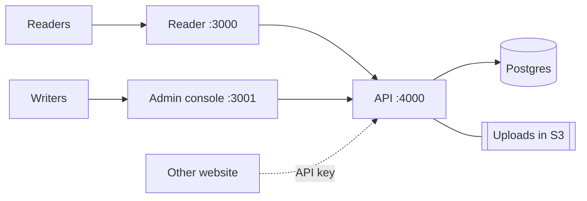

# Introduction

Czy Blog is a self-hosted blog platform with two front ends:

- A **public reader** (`apps/web`) where visitors read published posts.
- An **admin console** (`apps/dashboard`) where writers create, edit, and publish.

They are **separate Next.js apps on separate origins**, so the reader contains no
admin routes — a visitor cannot reach a login or dashboard page by editing the URL.
A separate Fastify API handles data, auth, uploads, and scheduling, backed by
Postgres. It targets a single blog with one or more writers, not multi-tenant. There
is no public sign-up; an admin creates each account.

## Features

### Writing

- Tiptap block editor: headings, lists, links, images, syntax-highlighted code.
  Content is stored as a JSON document, not HTML.
- Cover image, excerpt, category, and tags per post.
- Local draft recovery: unsaved edits are kept in `localStorage` and offered back
  if newer than the server copy.

### Publishing

- Statuses: Draft, Pending review, Scheduled, Published, Archived.
- Scheduled publishing: a job runs every minute and publishes due posts.
- Review step: contributors submit; an editor or admin publishes.
- Soft delete: archives the post and reclaims its media.

### Roles

- Four ranked roles: Super admin > Editor > Author > Contributor
  ([permissions](architecture.md#roles-rbac)).
- First account becomes super admin; afterwards only a super admin adds users.
- Each request reloads the role from the database, so demotions apply immediately.
- Self-service password change signs out earlier sessions.

### Media

- Image uploads (JPEG, PNG, WebP, GIF, AVIF), up to 10 MB. The format is read
  from the file's bytes, so a mislabelled file is rejected.
- Stored in a private S3 bucket, streamed through the API's `/media` route.
- Scheduled cleanup removes uploads no post references.

### Reading and distribution

- Public reader with post list and post pages.
- Search/filter published posts by text, tag, or category.
- Per-post view counts.
- RSS feed at `/rss.xml` (25 latest).
- Search-engine basics: `/sitemap.xml`, `/robots.txt`, canonical URLs, Open Graph and
  `BlogPosting` structured data.
- Content API: other sites read published posts as JSON with an `x-api-key`.

### Operational

- JWT sessions for users; hashed API keys for headless consumers.
- Rate limit: 300 req/min per IP, 10/min on login and password change.
- Migrations run on API startup.
- Docker images for all three apps, run via Compose.

## Not included

- No public registration or comments.
- No built-in TLS — use a reverse proxy for HTTPS.
- Single-blog scope, not multi-tenant.

## Next

[Architecture](architecture.md) · [API](api.md) · [Environment](environment.md) ·
[Deployment](deployment.md) · [Development](development.md)
