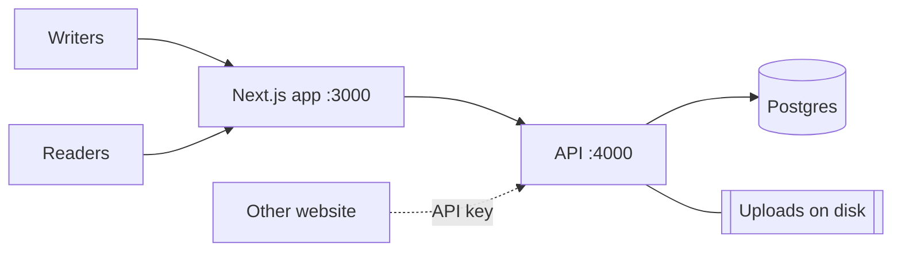

# Introduction

Czy Blog is a self-hosted blog platform. It has two parts that ship together:

- An **admin dashboard** where writers create, edit, and publish posts.
- A **public reader** where visitors read published posts.

Both are served by one Next.js app. A separate Fastify API handles data, auth,
uploads, and scheduling, backed by Postgres. It targets a single blog with one or
more writers — not multi-tenant or hosted SaaS. There is no public sign-up; an
admin creates each account.

## Features

### Writing

- Tiptap block editor: headings, lists, links, images, syntax-highlighted code.
  Content is stored as a JSON document, not HTML.
- Cover image, excerpt, category, and tags per post.
- Local draft recovery: unsaved edits are saved to `localStorage` and offered back
  if newer than the server copy. Nothing hits the server until you save.

### Publishing

- Statuses: Draft, Pending review, Scheduled, Published, Archived.
- Scheduled publishing: a job runs every minute and publishes posts whose time has
  arrived.
- Review step: contributors submit for review; an editor or admin publishes.
- Soft delete: archives the post and reclaims its media instead of deleting the row.

### Roles

- Four roles, ranked: Super admin > Editor > Author > Contributor
  ([permissions](architecture.md#roles-rbac)).
- First account created becomes super admin; afterwards only a super admin adds
  users.
- Each request reloads the role from the database, so demotions apply immediately.
- Self-service password change; it signs out sessions started before the change.

### Media

- Image uploads (JPEG, PNG, WebP, GIF, AVIF), up to 10 MB. The format is read
  from the file's bytes, so a mislabelled file is rejected.
- Stored on disk, served from `/uploads`; public base URL is configurable.
- Scheduled cleanup removes uploads no post references.

### Reading and distribution

- Public reader with post list and post pages.
- Search and filter published posts by text, tag, or category.
- Per-post view counts.
- RSS feed at `/rss.xml` (25 latest).
- Content API: other sites read published posts as JSON with an `x-api-key`.

### Operational

- JWT sessions for users; hashed API keys for headless consumers.
- Rate limit: 300 requests/minute per IP, 10/minute on login and password change.
- Migrations run automatically on API startup.
- Docker images for both apps, run via Docker Compose.

## Not included

- No public registration or comments.
- No built-in TLS — use a reverse proxy for HTTPS.
- No object storage; uploads live on a local disk/volume.
- Single-blog scope, not multi-tenant.

## Next

[Architecture](architecture.md) · [API](api.md) · [Environment](environment.md) ·
[Deployment](deployment.md) · [Development](development.md)
